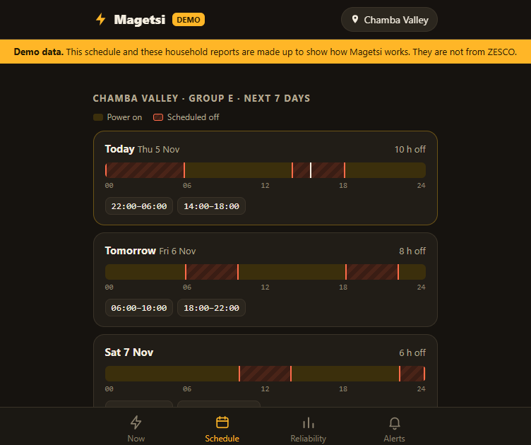
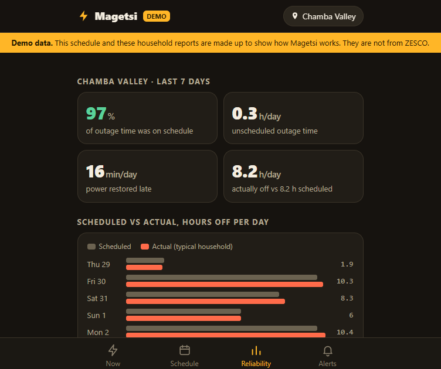
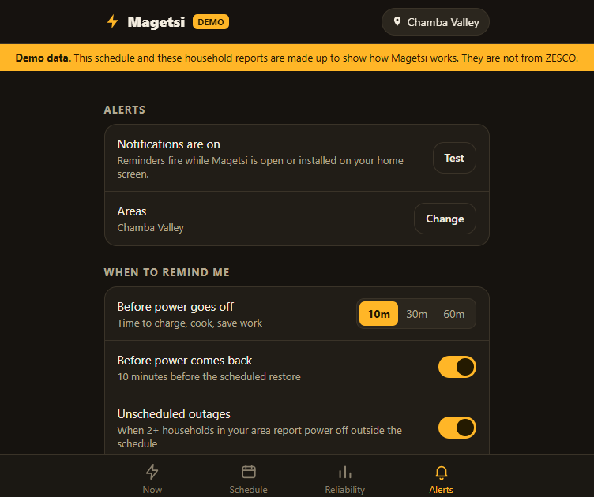

# Magetsi: load-shedding schedule, alerts and outage log (Zambia)

Households see their area's ZESCO load-shedding schedule, get alerts before power goes off and before it comes back, and log real outages with one tap. Those logs show how well each area's schedule is kept: on-schedule %, extra hours, and late restoration.

**[Try the live demo](https://john-chola.github.io/Magetsi/)**: runs in your browser with a made-up schedule and reports (clearly labelled), no sign-up. Push alerts, SMS and the admin page need the full server (see [Run it](#run-it-nodejs-225-or-newer-nothing-to-install)).

<p>
  
  
  
</p>
<sub>Screenshots from the demo, with made-up data.</sub>

- **Push alerts** reach phones even when the app is closed (Web Push).
- **SMS alerts** work on any phone, with no data needed (through Africa's Talking).
- **Up to 5 saved areas** per phone (home, work, family). Alerts cover all of them.
- **A public dashboard** at `/dashboard` compares every area, with a CSV download.
- **Towns:** Lusaka, Kitwe, Ndola, Kabwe and Livingstone, with 164 areas mapped to ZESCO's groups.

## Run it (Node.js 22.5 or newer, nothing to install)

```bash
npm start            # or: node server.js
# app: http://localhost:3000   admin: /admin   dashboard: /dashboard
npm test             # 64 unit + API tests
npm run schedule     # turn ZESCO's weekly grid into import CSV (see below)
npm run backup       # snapshot magetsi.db into backups/ (safe while running; keeps the newest 30)
npm run build:demo   # dist/magetsi-demo.html, a single file that runs with no server (no push/SMS)
```

- The first run creates `magetsi.db` (SQLite) with 164 areas in 5 towns and **no schedule** (see [Importing a schedule](#importing-a-schedule)).
- To show the app working, start a **demo copy** with `SEED_DEMO=1` and its own database (on Windows: double-click `start-demo.cmd`, which uses `magetsi-demo.db`). It keeps a made-up rotation 14 days ahead and adds synthetic household reports every hour. Every page shows a "Demo data" banner, push alerts start with "DEMO:", the CSV export is labelled, and SMS is never sent for real.
- An existing database is upgraded on start: new tables are created, and areas and groups are brought in line with `public/core.js`. Existing data is kept.
- Delete `magetsi.db` to start fresh.
- On Windows with ngrok, double-click `start-public.cmd` to open Magetsi and the public link in two windows. Secrets such as `AT_API_KEY` can go in a git-ignored `.env` file (one `KEY=VALUE` per line), which the script loads.
- Runs fine on a low-spec laptop: no npm packages and no build step.

## Settings (environment variables)

| Variable | What it does |
| --- | --- |
| `ADMIN_TOKEN` | Optional. Setup token for the first admin, and lets scripts call the admin API with an `X-Admin-Token` header. Admins sign in with their own accounts (see Admin page). |
| `VAPID_SUBJECT` | `mailto:you@yourdomain` or an `https://` URL. Push services use it to contact you. Set this in production. |
| `VAPID_PUBLIC_KEY`, `VAPID_PRIVATE_KEY` | Optional. If unset, keys are generated once and stored in the database. If you change keys, phones re-subscribe the next time they open the app. |
| `AT_API_KEY`, `AT_USERNAME` | Africa's Talking credentials. With no key, SMS runs in **log mode**: messages are printed and shown on `/admin`, not sent. `AT_USERNAME=sandbox` uses their sandbox. |
| `AT_SENDER_ID` or `AT_SHORTCODE` | Sender for outgoing SMS. `AT_SHORTCODE` is also shown in the app ("text JOIN CHILENJE to …"). |
| `SMS_INBOUND_KEY` | Secret for the incoming-SMS webhook. Defaults to `ADMIN_TOKEN`, or a random key stored in the database. The full callback URL is shown on `/admin`. |
| `SMS_DAILY_LIMIT` | Cost guard: maximum SMS per day (default 2000). |
| `TRUST_PROXY` | Set to `1` when running behind a hosting proxy (Render, Railway, Fly, Nginx, Cloudflare), so admin sign-in limits use each visitor's real IP. Leave unset if the app is reachable directly. |
| `PORT`, `DB_FILE` | Port to listen on (default 3000) and database location (default `./magetsi.db`). On a host, put `DB_FILE` on a persistent disk. |

## How alerts work

Every minute the server works out which alerts are due for every push subscription and SMS subscriber, using the same rules the app uses (`dueAlerts` and `smsDue` in `public/core.js`). Each alert is sent once. A failed send is retried the next minute. Subscriptions the browser has dropped are deleted.

**Push:** when someone allows notifications, the app subscribes and sends the server its saved areas and settings. If push isn't available (demo mode, an unsupported browser, or iPhone without adding Magetsi to the home screen), the phone falls back to its own reminders, which need the app open. The server only sends to browser push services (Google, Mozilla, Microsoft, Apple). Change that list with `PUSH_ENDPOINT_HOSTS`.

**SMS:** there are two messages, each one SMS long:
- today's times, sent once between 05:30 and 07:00;
- a reminder 30 or 60 minutes before each outage (none from 23:00 to 05:00).

There are two ways to sign up:
1. **From the app** (Alerts tab): enter a number and area, then type in the 6-digit code that arrives by SMS. This means nobody can sign up someone else's number.
2. **By texting** the shortcode: `JOIN CHILENJE`, `TIMES`, `STOP`, `HELP`. A bare area name also works, and a leading `MAGETSI` keyword is ignored.

To connect Africa's Talking, set the incoming-messages callback to `https://your-host/api/sms/inbound?key=SMS_INBOUND_KEY`. You can try commands without a shortcode in the "Try an incoming SMS" box on `/admin`.

## Admin page

Each admin has their own username and password. `/admin` shows only a sign-in form to anyone who isn't signed in. The admin pages are in `admin/`, outside `public/`, so they can't be fetched directly.

**Creating the first admin.** On a fresh install the server prints a setup token:
```
[magetsi] No admin account yet. Open /admin and enter this setup token: Xy3…
```
Open `/admin`, enter that token (or your `ADMIN_TOKEN`, if set), and choose a username and password. The setup form disappears once an admin exists.

**Adding more admins.** In the **Admins** section of the admin page, enter a username. Magetsi shows a temporary password once; give it to the person privately. At their first sign-in they must choose their own password before they can do anything else. The same section can reset someone's password (also a temporary one) or disable an account. Both sign that person out. Nobody can disable themselves or the last active admin.

**From the command line.** Use this if everyone is locked out, or to create the first admin without the web form:
```bash
npm run admin -- list
npm run admin -- create <username>    # prints a temporary password
npm run admin -- reset <username>     # new temporary password; also re-enables the account
npm run admin -- disable <username>
```

**Security details**
- Passwords are hashed with scrypt (`lib/admins.js`). They need at least 10 characters and must not contain the username.
- Signing in sets a session cookie (HttpOnly, SameSite=Strict, and Secure over HTTPS). It lasts 12 hours, or until **Sign out**. The database stores only a hash of the session id. Changing your password signs out your other sessions.
- After 10 wrong passwords for a username, or from one IP address, sign-in for it pauses for 15 minutes. Successful sign-ins don't count.
- Admin API requests must be JSON, which blocks cross-site form attacks.
- **Recent activity** on the admin page lists sign-ins, failed sign-ins, schedule imports and account changes, with who did them.
- `ADMIN_TOKEN` is optional. If set, scripts can call `/api/admin/*` (except account management) with an `X-Admin-Token` header, and it serves as the setup token.
- Upgrading from the shared-token version signs everyone out. Create the first admin with the setup token or `npm run admin -- create`.

## Areas and groups

ZESCO splits each town into load-management **groups** (feeders) and publishes which areas each group covers. Groups are numbered per town: Lusaka's Group A and Kitwe's Group A are different feeders on different times. So group codes carry a town prefix:

| Town | Codes |
| --- | --- |
| Lusaka | `LSK-A` to `LSK-E` |
| Kitwe | `KIT-A` to `KIT-C` |
| Ndola | `NDL-A` to `NDL-D` |
| Kabwe | `KBW-A` to `KBW-D` |
| Livingstone | `LVS-A` to `LVS-C` |

The 164 areas in `public/core.js` (`TOWN_AREAS`) come from ZESCO's load management schedule of **March 2024**. That was the latest one published: in June 2026 ZESCO said it did not expect nationwide load management to return. ZESCO lists areas feeder by feeder, so a few neighbourhoods are split between groups street by street. Each one is filed under the group that covers most of it.

Area ids are stable, because saved areas, SMS sign-ups and outage reports point at them. To add an area, give it the next free id. Never renumber or reuse one. An area removed from the list is **retired** on the next start: it is hidden, and its old reports are kept.

## Importing a schedule

**From ZESCO's grid.** ZESCO publishes a table with time bands down the side, dates across, and a group letter in each cell. The table repeats every few weeks. Copy one cycle into a pattern file (see [`schedules/zesco-2024-03.json`](schedules/zesco-2024-03.json)):

```json
{ "towns": { "Lusaka": {
  "start": "2024-03-11", "days": 7,
  "bands": ["18:00-02:00", "00:00-08:00", "05:00-13:00", "09:00-17:00", "15:00-23:00"],
  "cycle": [["A","B","C","D","E"], ["A","B","D","E","C"], ["A","B","E","C","D"]] } } }
```

`cycle[k][i]` is the group that is off in band `i` during week `k`. Use `"A&B"` for two groups and `""` for none. Then turn the pattern into CSV for any dates:

```bash
npm run schedule -- schedules/my-schedule.json --from 2026-11-09 --days 28 --out schedule.csv
```

**The CSV itself.** Sign in at `/admin` and paste one slot per line, in Zambia time (CAT, UTC+2):

```
group,date,start,end
LSK-C,2026-11-09,05:00,13:00
LSK-A,2026-11-09,18:00,02:00   <- end before start = runs past midnight
```

With no schedule imported, the app says no schedule is published and still works as an outage log: households report outages, and neighbours get alerted when several report at once.

`schedules/zesco-2024-03.json` is a historical example. Don't import it as a current schedule.

## Testing on your phone

Browsers allow notifications and push only on `localhost` or HTTPS. To try it on a phone, use a tunnel:
`cloudflared tunnel --url http://localhost:3000`, then open the https link on the phone and choose "Add to Home screen". On iPhone (iOS 16.4+), push only works after adding Magetsi to the home screen.

## Files

| File | What it does |
| --- | --- |
| `server.js` | HTTP server, SQLite, REST API, rate limits, the alert loop, dashboard, 24 h auto-close |
| `lib/webpush.js` | Web Push with no packages: VAPID (RFC 8292) and payload encryption (RFC 8291), with a check against the RFC test vector |
| `lib/sms.js` | Africa's Talking sender, with log mode |
| `public/core.js` | Shared by server and browser: schedule maths, adherence, alert rules, SMS commands, CSV, towns and areas, demo data |
| `public/app.js` | The PWA: Now / Schedule / Reliability / Alerts, saved areas, push subscription, SMS sign-up, demo fallback |
| `public/index.html` | Markup and styles |
| `public/sw.js` | Offline cache, push messages, notification clicks |
| `public/dashboard.html` | Public adherence dashboard |
| `admin/admin.html` | Admin page (sent only to signed-in sessions): schedule CSV import, alert overview, SMS outbox and test box |
| `admin/login.html`, `setup.html`, `password.html` | Sign-in, first-admin setup and change-password forms |
| `lib/admins.js` | Admin accounts: scrypt password hashes, sessions, audit log |
| `admin-cli.js` | `npm run admin`: list, create, reset, disable admins |
| `schedule-cli.js`, `schedules/` | `npm run schedule`: ZESCO pattern file to import CSV, with a March 2024 example |
| `backup.js` | `npm run backup`: consistent copy of the database into `backups/` |
| `start-public.ps1`, `start-public.cmd`, `start-demo.cmd` | Windows: start Magetsi (or the demo copy) and the ngrok link together, loading `.env` |
| `test/` | `node --test` suites |

## API

| Method and path | Does |
| --- | --- |
| `GET /api/areas` | Areas (with town), groups, towns |
| `GET /api/schedule?area=ID&days=7` | Slots for the area's group |
| `GET /api/status?area=ID&device=D` | Scheduled state, next change, live community reports, your open outage |
| `GET /api/stats?area=ID&days=7` | Adherence (hidden under 3 reporting households) |
| `GET /api/dashboard?days=7\|30` | Adherence for every area |
| `GET /api/dashboard.csv?days=7\|30` | The same as a CSV download |
| `POST /api/outages/off` `{area, device}` | Power went off |
| `POST /api/outages/on` `{device}` | Power is back |
| `POST /api/outages` `{area, device, off_at, on_at}` | Log a past outage (ms timestamps) |
| `GET /api/push/key` | VAPID public key |
| `POST /api/push/subscribe` `{device, subscription, areas, settings}` | Save or update this phone's push subscription |
| `POST /api/push/unsubscribe` `{device}` | Remove it |
| `POST /api/push/test` `{device}` | Send a test push |
| `GET /api/sms/info` | SMS mode and shortcode |
| `POST /api/sms/start` `{device, phone, area, daily, before}` | Send a sign-up code |
| `POST /api/sms/verify` `{device, phone, code}` | Confirm the code; alerts start |
| `POST /api/sms/stop` `{device, phone}` | Stop (only from the device that signed up) |
| `POST /api/sms/inbound?key=K` form `from, text` | Africa's Talking incoming-SMS webhook |
| `POST /admin/setup` · `/admin/login` · `/admin/password` · `/admin/logout` (forms) | First admin, sign in, change password, sign out |
| `GET /api/admin/admins` · `POST /api/admin/admins` `{username}` | List admins, add one (returns a temporary password) |
| `POST /api/admin/admins/reset` `{id}` · `/disable` `{id, disabled}` | Reset password, disable or enable |
| `GET /api/admin/audit` | Recent admin activity |
| `POST /api/admin/slots` `{csv, replace}` (admin session or `X-Admin-Token`) | Import schedule |
| `GET /api/admin/overview` (admin session or `X-Admin-Token`) | Subscriber counts and recent SMS |

## Next steps

1. When ZESCO publishes a new schedule, write it as a pattern file and import it (see above). Check the area lists against it.
2. Get an Africa's Talking shortcode and sender ID, and set a budget with `SMS_DAILY_LIMIT`.
3. Host on HTTPS with `VAPID_SUBJECT` set, then test push on Android Chrome and an iPhone added to the home screen.
4. USSD menu (`*xxx#`) as a second channel for basic phones.
